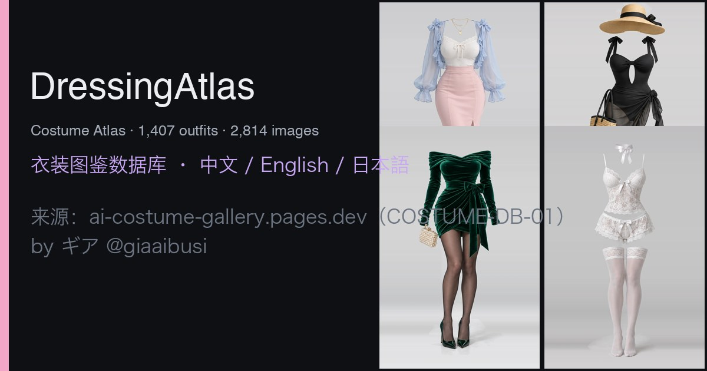

<div align="center">



# DressingAtlas

**三语 AI 服装参考图库 · 1,407 套原创服装 / 2,814 张图像 · 8 个分类**

中文 · English · 日本語

<p>
  <a href="https://kevin96625-coder.github.io/DressingAtlas/"><strong>在线体验 →</strong></a> ·
  <a href="https://github.com/kevin96625-coder/DressingAtlas">GitHub 仓库</a> ·
  <a href="https://github.com/kevin96625-coder/DressingAtlas/issues">问题反馈</a>
</p>

[](https://kevin96625-coder.github.io/DressingAtlas/)


[在线体验](#在线体验) ·
[项目简介](#项目简介) ·
[数据概览](#数据概览) ·
[快速开始](#快速开始) ·
[数据与校验](#数据与校验) ·
[部署](#部署) ·
[致谢与版权](#致谢与版权)

</div>

> **原作者项目**:[COSTUME-DB-01](https://ai-costume-gallery.pages.dev/) · **作者**:[ギア (@giaaibusi)](https://x.com/giaaibusi)
>
> **结构参考**:[RuiC-PoseAtlas](https://github.com/HRuiCcc/RuiC-PoseAtlas)(本项目的目录结构、三语方案与数据管道均以其为范本)

---

## 项目简介

**DressingAtlas** 是一个完全静态、零依赖的 AI 服装参考图库。它把 1,407 套 AI 生成的原创服装(不含人物、仅服装,2:3 构图)整理成可检索的卡片,按 **春季 / 夏季 / 秋季 / 冬季 / 内衣 / 派对 / 泳装 / 性感** 八个分类归档;配合大图浏览、键盘切换、关键词复制与原图下载,方便在 AI 绘画、角色设计与漫画创作中快速取用服装灵感。

每套服装都带有一段英文提示词关键词(如 `denim`、`lace`、`白`),可以直接复制到 AI 绘图工具中作为服装描述使用;编号(如 `SPR-0001`)也可用于建立自己的素材索引。

它同时是一个可以独立部署的前端作品:**纯 HTML + CSS + ES Modules**,没有框架、没有打包器、没有运行时依赖。克隆下来用一个静态服务器打开即可;需要部署时,直接交给 GitHub Pages、Cloudflare Pages、Netlify 或任意静态托管即可。

## 在线体验

> **https://kevin96625-coder.github.io/DressingAtlas/**

支持 `?lang=zh|en|ja`、`?category=`、`?q=` 与 `?item=SPR-0001` 深链接。

### 这个项目适合谁

- **AI 绘画创作者**:按分类与关键词寻找服装参考,或直接复制提示词使用。
- **角色设计 / 漫画作者**:为角色快速匹配四季、场合与风格的着装。
- **前端学习者**:一个无框架、数据驱动、三语 i18n 的完整静态项目范例。

## 数据概览

| 分类 | key | 数量 |
| --- | --- | ---: |
| 春季 | `SPR` | 215 |
| 夏季 | `SUM` | 254 |
| 秋季 | `AUT` | 244 |
| 冬季 | `WIN` | 253 |
| 内衣 | `LNG` | 199 |
| 派对 | `PTY` | 48 |
| 泳装 | `SWM` | 54 |
| 性感 | `SXY` | 140 |
| **合计** | | **1,407** |

图片规格:缩略图 360 × 540 WebP(`thumbs/`,按分类子目录存放);展示图最高 1366 × 2048 WebP(`img/`,少数为略小的 2:3 尺寸);另有无损 1366 × 2048 PNG 原图,运行 `npm run fetch-images -- --png` 抓取到本地 `png/`(约 1.3 GB)。

## 快速开始

```bash
git clone https://github.com/kevin96625-coder/DressingAtlas.git
cd DressingAtlas
npm start          # 等价于 python3 -m http.server 8124 --bind 127.0.0.1
```

打开 <http://127.0.0.1:8124/> 即可浏览。仓库已包含全部图片,无需额外下载。

> 本地运行时,若存在 `png/` 目录(`npm run fetch-images -- --png` 生成),大图弹窗的下载按钮会自动切换为**无损 PNG 原图**;GitHub Pages 等静态托管上则自动回退为同分辨率 WebP,页面行为完全一致。

## 数据与校验

```bash
npm run data           # 从 scripts/source/costume-db.json 重建 data/costumes.json
npm run fetch-images   # 从原站补齐 thumbs/ 与 img/(幂等,可反复运行)
npm run fetch-images -- --png   # 额外拉取原站无损 PNG 原图到 png/(约 1.3 GB,已 gitignore)
npm run verify         # 离线完整性校验(见下)
```

`npm run verify` 会检查:

- 数据 schema、1,407 条记录、8 个分类计数与原始抓取文件逐条对账(编号、关键词、路径)；
- 分类与界面文案的中 / 英 / 日三语完整性(键集合、数组长度、类型一致)；
- **全部 2,814 张图片**:存在性、WebP 签名、宽高(缩略图 360 × 540,展示图 2:3 竖图)；
- **本地 png/ 目录(若已抓取)**:1,407 张 PNG 原图的签名与尺寸;未抓取时跳过并提示；
- 页面接线:app.js 引用的每个元素 id、语言切换按钮、i18n 键、作者声明均存在。

## 部署

纯静态目录,任选其一:

- **GitHub Pages**:仓库设置中把分支发布即可(本项目在线版即为此方式)。
- **Cloudflare Pages / Netlify / Vercel**:构建命令留空,输出目录为仓库根目录。
- 仓库自带 `_headers`(图片长缓存)与 `robots.txt`,Cloudflare Pages 可直接使用。

## 目录结构

```
DressingAtlas/
├── index.html              # 单页入口
├── assets/
│   ├── css/app.css         # 深色主题样式
│   ├── js/app.js           # 渲染 / 筛选 / 搜索 / 大图预览
│   ├── js/i18n.js          # 中 / 英 / 日 UI 字典与渲染
│   └── favicon.svg
├── data/costumes.json      # 全量数据(含三语分类名与搜索别名)
├── thumbs/<分类>/<id>.webp  # 360 × 540 缩略图
├── png/<分类>/<id>.png      # 无损原图(fetch --png 后生成,已 gitignore)
├── img/<分类>/<id>.webp     # 最高 1366 × 2048 展示图
├── scripts/
│   ├── import-data.mjs     # 原始抓取 → 稳定 schema
│   ├── fetch-images.mjs    # 图片补齐(支持 --png)
│   ├── verify.mjs          # 离线完整性校验
│   └── source/costume-db.json  # 原始抓取(留档溯源)
├── docs/                   # 界面预览截图
├── og-cover.jpg            # 社交分享封面
├── _headers / robots.txt
└── LICENSE                 # 代码 MIT;图片版权归原作者(见下)
```

## 致谢与版权

本仓库能存在,完全依赖以下项目与作者,在此郑重致谢:

- **图片与数据的原作者:[ギア (@giaaibusi)](https://x.com/giaaibusi)**,原始项目 [COSTUME-DB-01(衣装集)](https://ai-costume-gallery.pages.dev/)。所有图片均为原作者以 t2i 方式生成的原创虚构服装设计。原作允许在作品制作中免费使用(含商用、编辑与参考),但**禁止对图片数据本身进行再分发、转载与转售**。本仓库仅作学习性质的镜像与整理,图片版权归原作者所有;若权利方有任何异议,请提 issue,我会立即处理下架。
- **结构与灵感来源:[RuiC-PoseAtlas](https://github.com/HRuiCcc/RuiC-PoseAtlas)**(作者 HRuiCcc)。本项目的目录布局、「原始抓取 → 数据构建 → 三语界面 → 离线校验」的管道设计,以及页面交互形态均以其为范本学习和改编,感谢这个优秀的零依赖静态项目范例。
- 中文 / 英文分类名与全部界面翻译由 DressingAtlas 维护;日文分类名与提示/注意事项文案改编自原站。

**DressingAtlas 的代码(不含 `thumbs/`、`img/` 图片数据)以 [MIT 许可证](LICENSE) 发布。**
